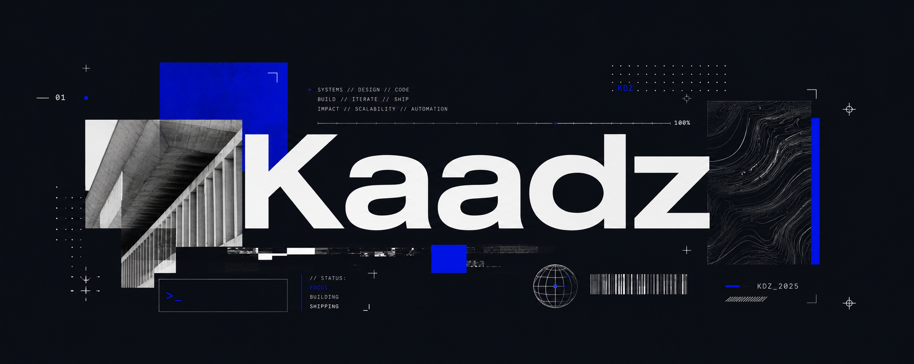

  

 

### `kaadipranav` // systems, agent infrastructure, sandboxing
I build deterministic guardrails, context engines, and zero-trust execution sandboxes for autonomous software workflows.

---

<table>
  <thead>
    <tr>
      <th width="30%">System</th>
      <th width="45%">Problem Space & Core Mechanism</th>
      <th width="25%">Primitives</th>
    </tr>
  </thead>
  <tbody>
    <tr>
      <td>
        <b><a href="https://github.com/WatchLLM/watchllm-oss">WatchLLM</a></b> 
        <code>v0.1.1</code> · Agent Governance
      </td>
      <td>
        In-flight AST interceptor for agent tooling. Validates file mutations, secrets exposure, and boundary violations before reaching disk.
      </td>
      <td>
        <code>Rust</code> <code>Tree-sitter</code> 
        <code>TypeScript</code> <code>IPC</code>
      </td>
    </tr>
    <tr>
      <td>
        <b><a href="https://github.com/klyd-studio/klyd-harness">Klyd</a></b> 
        <code>v0.2.2</code> · PyPI Package
      </td>
      <td>
        Git-hook-driven decision harness. Ingests commit diffs into SQLite via recursive CTEs to enforce architectural memory across agent prompts.
      </td>
      <td>
        <code>Python 3.11</code> <code>SQLite</code> 
        <code>Git Hooks</code> <code>POSIX</code>
      </td>
    </tr>
    <tr>
      <td>
        <b><a href="https://github.com/Codify-PSBB/CODIFY-WEBAPP-CORE">Codify</a></b> 
        <code>Live Tool</code> · PSBB Labs
      </td>
      <td>
        Client-side sandbox executing untrusted student submissions inside in-browser WASM with zero server-side attack surface.
      </td>
      <td>
        <code>Pyodide (WASM)</code> 
        <code>Cloudflare D1</code> <code>Monaco</code>
      </td>
    </tr>
  </tbody>
</table>

---
